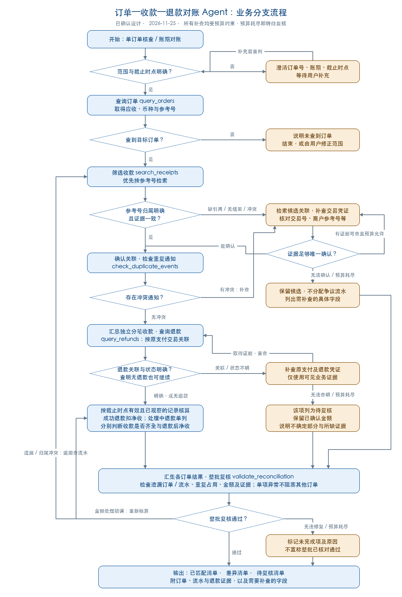

# 数据来源与合成说明

归档日期：2026-11-25。本文记录已完成的数据准备与验收，依据 [README](../README.md)、[执行验收汇总](../datasets/verification_report.json)、[来源审计](../datasets/source_audit.json)及[完整统计](../datasets/prepared/statistics.json)。本轮业务工具已进入实现阶段，最终工具与 Agent 验证结果以 README 后续更新为准。

## 1. 公开来源、许可与下载事实

公开底座由 Olist 发布，包含 2016～2018 年匿名巴西电商订单。原始发布页为 https://www.kaggle.com/datasets/olistbr/brazilian-ecommerce ，许可为 **CC BY-NC-SA 4.0**。项目执行验收记录记载于 2026-11-25 重新核对发布页的许可栏；许可原文：https://creativecommons.org/licenses/by-nc-sa/4.0/ 。

本项目数据及其数据衍生物用于非商业课程实验，应保留 Olist 署名、来源、变更说明，并按相同许可分享。公开可下载不等于无限制使用。订单筛选、金额整数分转换、业务标识重建、合成支付退款及异常、等额干扰订单修改均属于本项目变更，不能归因于 Olist 的真实异常日志。

本次正式生成唯一源目录为 `datasets/raw_kaggle/`，四表实际通过 Kaggle 无凭证公开逐文件 API 下载，未读取 Kaggle Token。稳定请求形式为 `https://www.kaggle.com/api/v1/datasets/download/olistbr/brazilian-ecommerce/{filename}`，返回重定向 ZIP 后解压验证 CSV。[下载清单](../datasets/raw_kaggle/source_manifest.json)记录请求与最终地址、载荷及 CSV SHA-256、行数和字节数。最终签名地址可能过期，复跑应使用稳定请求接口；上游 Kaggle 版本号未独立确认，文件哈希不等于上游版本号。

下表行数不含表头，字节数对应 Kaggle 实际下载的 CSV，依据 [source_audit.json](../datasets/source_audit.json)。

| 文件 | 用途 | 数据行数 | CSV 字节数 |
| --- | --- | ---: | ---: |
| `olist_orders_dataset.csv` | 订单状态、下单时间与订单连接 | 99,441 | 17,654,914 |
| `olist_order_items_dataset.csv` | 商品金额及运费汇总 | 112,650 | 15,438,671 |
| `olist_order_payments_dataset.csv` | 源支付金额、方式与分期属性 | 103,886 | 5,777,138 |
| `olist_customers_dataset.csv` | 客户连接及复购客户切分隔离 | 99,441 | 9,033,957 |

另保留固定提交镜像 https://github.com/cstuer/olist-ecommerce-analysis ，提交 `21baca68a891817e8370b832273ba62d05a3d719`，目录 `raw/`。本地镜像位于 `datasets/raw/`，记录于[镜像清单](../datasets/raw/source_manifest.json)，历史网络失败见[下载尝试记录](../datasets/raw/download_attempts.json)。它未被伪记为 Kaggle 下载，也不是本次正式生成输入。

来源审计显示：明细、支付、客户三表逐字节一致；orders 字节不同，但忽略行序后的 CSV 记录多重集合一致，两侧独有记录均为 0。只获取上述四表，未获取评论、地理位置、商品或卖家文件。

## 2. 原始、派生、合成与修改字段

| 类别 | 内容及处理 | 解释边界 |
| --- | --- | --- |
| `original` | 保留源订单记录、明细、支付行、客户唯一标识及支付方式/分期属性 | 源支付行不等于有真实到账时间的银行流水 |
| `derived` | 以 `Decimal` 转换为 BRL 整数分，计算明细与支付总额、筛选订单与切分源池 | 不使用二进制浮点数直接对账 |
| `synthetic` | 业务订单/交易/通知标识、商户引用、支付事件时间与成功状态、退款、重复通知及异常 | 全部为实验构造，不声称真实发生 |
| `modified` | 等额干扰订单的应收等为制造歧义而调整的字段 | 在隐藏 provenance 中明确标记，不将修改标志提供给 Agent 提示答案 |

合格订单须已送达、关联完整、金额为正，且明细总额（含运费）与源支付总额精确相等。源差额订单直接筛除，不能将差额解释成退款。源 `payment_installments` 仅是支付分期属性，不能解释成真实到账分笔；分笔收款场景由生成器单独拆分，保持金额守恒。

源池合格订单 95,904 个：train 67,290、val 9,475、test 19,139。筛除未送达 2,963、金额/字段不一致 573、关联缺失 1，与原始 99,441 单总数守恒。这些筛选统计不证明被排除订单存在真实业务异常。

## 3. 时间、归属与金额规则

实验统一使用固定 `UTC-03:00`。源下单时间没有时区；添加偏移属于模拟假设，未恢复真实时区、夏令时或真实到账时间。

- 交易生效时间与通知观察时间均须 `<= cutoff`；等于截止时点计入，晚 1 秒排除。账期订单范围使用 `[period_start, period_end)`。
- 优先按订单强引用关联；缺失时可由唯一商户引用恢复。金额相同只能产生候选，即使候选仅一个也不能凭金额强配；歧义保留未分配交易并输出 `review`。
- 同一 `transaction_id` 的重复通知只计一笔交易；冲突通知应报错或补查，每笔交易只可分配一次。
- 退款必须引用截止前可确认的成功收款。成功退款才扣减净收；处理中退款单列。对每笔原交易，累计成功退款不得超过原成功收款，支持分笔收款和多次退款核查。

核心金额口径如下，单位均为 BRL 整数分：

```text
collection_gap_cents = expected - received
net_cents = received - refunded
net_vs_original_cents = expected - net
```

`collection_gap_cents` 用于判断少收；`net_vs_original_cents` 表示相对原应收的净差。正常成功部分退款可同时满足“原款收齐”和“净收减少”，不能据此误报少收。`pending_refund_ids / pending_refund_cents` 保留处理中退款，不从净收扣除。

## 4. 切分、参考答案与访问隔离

先按客户划分源池，公式为：

```python
int(SHA256(f"{seed}:{customer_unique_id}").hexdigest()[:8], 16) % 100
# 0～69 train；70～79 val；80～99 test
```

在各自源池内选择订单，每个源订单只进入一个任务，避免同订单变体跨任务复用；客户也不跨切分。业务 ID 随机重建，不编码场景、类别、切分或源订单 ID。单订单歧义任务可能额外包含候选订单；每个 `period_batch` 任务实际包含同一切分的 3 个源订单。

| 产物 | 内容与访问边界 |
| --- | --- |
| `agent_visible/rules.json` | 可见业务规则 |
| `agent_visible/{split}/tasks.jsonl` | 任务输入 |
| `agent_visible/{split}/environments/*.json` | 订单及模拟收款退款环境快照 |
| `hidden/{split}/facts.jsonl` | 隐藏事实、源记录与逐实体/字段 provenance |
| `hidden/{split}/ground_truth.jsonl` | 独立参考答案 |
| `hidden/{split}/source_assignments.jsonl` | 源订单与客户分配审计 |
| `statistics.json` | 版本、种子、筛选、计数、代码及产物哈希和验证结果 |

`scripts/reference.py` 从隐藏事实账本产生参考答案；`scripts/validate_data.py` 从可见引用与事件重算，再逐题比对参考答案。验证器可访问隐藏侧做验收；未来 Agent 只能经业务工具读取 `agent_visible/`，不能挂载隐藏答案、原始 CSV、统计、生成器和参考代码。目前目录分离已完成，模型运行时访问控制仍需实际落实。

## 5. 2026-11-25 实际验收统计

环境为 Python 3.13.12，生成版本 `olist-sim-v2`，规则版本 `brl-reconciliation-v1`，seed `20261124`。数据脚本仅依赖 Python 标准库。以下来自[执行验收汇总](../datasets/verification_report.json)和[详细统计](../datasets/prepared/statistics.json)，不是本次 Markdown 归档重新跑出的结果。

| 切分 | 任务 | 源订单/可见订单 | 单订单任务 | 三订单批量任务 | 事件通知 | 独立交易 | 退款事件 |
| --- | ---: | ---: | ---: | ---: | ---: | ---: | ---: |
| train | 200 | 386 | 111 | 89 | 551 | 537 | 105 |
| val | 50 | 96 | 28 | 22 | 137 | 133 | 26 |
| test | 360 | 696 | 200 | 160 | 996 | 972 | 192 |
| 合计 | 610 | 1,178 | 339 | 271 | 1,684 | 1,642 | 323 |

- 32 项数据业务测试通过，覆盖整数分、分笔守恒、成功/处理中退款、多次退款上限、重复/冲突通知、引用冲突、同额歧义、截止边界、批量范围及错误输入；包含 11 场景 × 2 请求模式子测试。
- smoke 48 题（12/12/24），核验 61 个产物文件；prepared 610 题全部逐题重算一致，核验 623 个产物文件。
- 跨切分源订单交集为 0、客户交集为 0；业务订单、交易、事件 ID 无跨任务复用。54 个目标订单正确标为待复核。
- 测试集 `basic / cross_tool / boundary` 各 120 题，各完整切分均覆盖全部 11 场景。

场景为 `normal`、`split_receipts`、`partial_refund`、`pending_refund`、`recoverable_reference`、`multiple_refunds`、`duplicate_event`、`ambiguous_amount`、`cutoff`、`refund_cutoff`、`refund_observed_cutoff`。

## 6. 复跑命令

下载、生成和逐文件哈希校验的命令见 [README 复跑命令](../README.md#复跑命令)。发布包包含生成后的任务和参考答案，原始 CSV 与镜像由下载脚本按需获取。

历史实际生成目录为 `datasets/smoke` 和 `datasets/prepared`；完整命令在 `verification_report.json`。`statistics.json` 记录代码、测试及产物哈希，代码或产物变化后旧数据校验可能报告哈希不一致，应在新目录按当前代码重新生成并记录结果，不能沿用旧验收数字宣称新版本通过。

## 7. 局限与用途边界

公开数据仅提供真实订单金额与源属性底座，支付退款事件、通知、异常和时间均为程序合成，不具备真实银行流水或渠道退款日志的生产代表性。固定时区、只选已送达且金额一致订单、简化状态等均带来选择偏差；未覆盖手续费、汇率、拒付、复杂退款状态迁移和一笔支付跨单分摊。

跨切分共享场景与请求模板。订单和客户无交集不代表模板、商户或时间域外泛化。批量任务是选中三单的封闭环境，其账期来自这些订单的下单区间，不是 Olist 全站月账单。smoke 与 prepared 同 seed 可重叠，不得合并成额外独立样本；仅 prepared 作为后续正式切分，留出集不得参与提示、奖励或模型调优。

当前环境任务及隐藏参考答案不是 SFT 工具轨迹，数据验证通过率不是 Agent 正确率。仍需模型或教师实际调用已实现工具、保留真实回执、独立核验，再转换训练样本和进行参数训练、同题权重对照。本轮 8 项工具进入实现阶段不代表这些后续阶段已完成。

业务设计见 [项目交互与设计过程记录](./项目交互与设计过程记录.md)。下图用于解释数据需支持的已确认业务流程，不是数据真实来源或实现完成证明。



[查看 SVG 矢量流程图](./对账Agent业务流程图.svg)。
