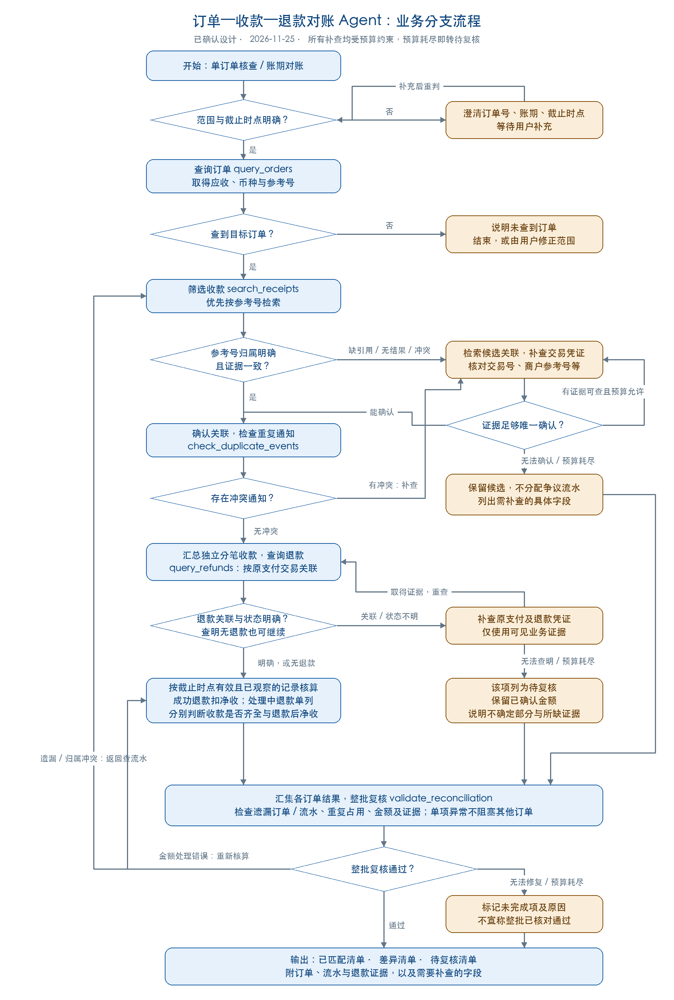

# 项目交互与设计过程记录

归档日期：2026-11-25。本记录是需求与设计决策摘要，不是逐字聊天记录。数据完成情况依据 [README](../README.md)、[执行验收汇总](../datasets/verification_report.json)和[完整数据统计](../datasets/prepared/statistics.json)；本轮实现授权依据 2026-11-25 09:02 的用户指令。业务工具后续实现与最终验证结果以 README 更新及对应测试记录为准。

## 1. 目标与决策经过

| 日期或阶段 | 用户需求与形成的决策 | 状态与边界 |
| --- | --- | --- |
| 2026-11-24：选题 | 选择模拟金融订单对账，围绕订单、收款、退款构建可调用工具的 Agent | 支持单订单核查与账期批量对账；不进行真实资金操作 |
| 框架讨论 | 比较 LangGraph 与 DeepSeek Harness；建议优先 LangGraph，便于 Python 工具、状态控制和训练评测衔接 | 建议尚未成为最终选择；框架与开放权重模型待确认 |
| 数据路线 | 采用公开 Olist 订单金额底座，加程序合成支付、退款、通知及异常 | 明确区分公开字段、派生字段、合成字段和修改字段 |
| 2026-11-25：数据准备验收 | 完成四表下载与来源审计、任务环境、隐藏参考答案、可见证据重算及数据测试 | 完整数据 610 题，train/val/test 为 200/50/360；不是 SFT 轨迹 |
| 业务设计审核 | 先确认业务流程，再从流程提取工具；批准条件分支、补查回路和待复核出口 | 旧 9 工具列表属于初稿，改为下述 8 项流程核心工具 |
| 2026-11-25 09:02：本轮授权 | 用户明确授权开始编写 8 项业务工具 | 本轮进入实现阶段；不预先宣称工具测试、Agent 集成或训练已完成 |
| 文档归档 | 使用 Markdown 保存过程记录和数据说明，引用现有流程图 | 保留同目录已有 DOCX、PNG、SVG |

课程项目要求包含至少 8 种实际业务工具、至少两类请求及一条依赖至少 3 种工具真实结果的调用链。后续应在相同任务、工具、提示与预算下比较基座和训练后权重，优先 SFT，RL 为可选扩展；确定性数据验收不能替代模型评测。

## 2. 已确认的业务流程

[查看 SVG 矢量流程图](./对账Agent业务流程图.svg)。该图表达已确认的业务设计，不表示 Agent 编排或全部工具已经实现。

1. 明确订单号或账期及截止时点。缺字段时明确列出需补充内容；订单不存在则说明未查到，等待修正范围或结束。
2. 查询订单，取得应收、币种与参考号；按参考号筛选收款。强引用和证据一致时确认归属，缺引用、空结果或冲突时检索候选并补查凭证。
3. 补查受调用预算和结束条件约束。证据足以唯一确认才分配交易；仍有歧义时保留候选、不分配争议流水，并明确缺少的交易号、商户参考号或其他证据。金额相同本身不足以确认归属。
4. 按独立交易识别重复通知；冲突通知进入补查。汇总分笔收款，退款按原支付交易关联，核查退款状态和累计金额。
5. 只核算截止前已生效且已观察的记录。成功退款减少净收，处理中退款单列；分别回答是否收齐及退款后净收，不能将正常退款当作少收。
6. 汇集各订单结果后整批复核，检查遗漏订单或流水、重复占用、金额及证据。一项异常不阻塞其他订单；可修复问题返回查询或核算，无法修复或预算耗尽则标注未完成项，不能宣称整批通过。
7. 输出已匹配、差异和待复核清单，附订单、流水、退款证据，以及需要补查的具体字段。

以上为业务约束与可选路径。实际 Agent 应根据工具回执选择下一步，不应将每类任务的完整正确调用顺序全部写死。

## 3. 工具设计从 9 项初稿调整为 8 项核心能力

| 本轮核心工具 | 从流程提取的职责 |
| --- | --- |
| `query_orders` | 按订单号或账期查询订单、应收与参考号 |
| `search_receipts` | 按参考号等条件筛选收款事件及业务记录 |
| `find_match_candidates` | 搜索可能关联，保留候选与依据，不凭同额强配 |
| `get_transaction_evidence` | 补查交易和关联凭证，支持冲突、缺字段及退款关联核查 |
| `check_duplicate_events` | 区分独立交易与重复通知，识别冲突 |
| `query_refunds` | 按原交易查询退款、状态及金额，支持分笔与多次退款 |
| `calculate_reconciliation` | 使用整数分核算收款、成功退款、净收和差额 |
| `validate_reconciliation` | 对整批归属、遗漏、重复占用、证据与金额进行复核 |

旧初稿中的 `query_receipts`、`calculate_order_balance`、`validate_match_plan` 等名称不能与本轮工具表混用；`get_reconciliation_rules` 和 `save_reconciliation_draft` 不再列为本轮 8 项流程核心工具。规则读取、输出组织等具体承载方式由实现确定，不能据此额外宣称工具数量。

## 4. 数据阶段的已验证成果

以下为 2026-11-25 数据阶段验收结果，来源为 [verification_report.json](../datasets/verification_report.json) 与 [statistics.json](../datasets/prepared/statistics.json)。

- 32 项数据业务测试通过；这是数据及参考计算测试数量，不是本轮 8 工具的测试数量。
- smoke 共 48 题（12/12/24），完整数据共 610 题（200/50/360），均通过可见证据重算与隐藏参考逐题比较。
- 完整数据使用 1,178 个源订单，包含 339 个单订单任务与 271 个真实三订单批量任务；单订单歧义任务还可包含候选干扰订单。
- 跨切分源订单交集、客户交集均为 0；测试集基础、跨工具、异常边界各 120 题。
- 54 个目标订单的参考结论为待复核。允许正确保留歧义，不以强行匹配追求表面完成率。

数据来源、许可、字段合成、复跑命令和局限见 [数据来源与合成说明](./数据来源与合成说明.md)。smoke 与 prepared 同 seed 可重叠，只使用 prepared 作为后续正式划分。

## 5. 实现边界与后续验收

本轮已获授权并进入 8 项业务工具实现阶段。归档时不将尚未产生的工具测试结果或模型运行结果记为已完成；历史验收汇总中的“9 种工具未完成”反映旧设计阶段，不能作为当前工具清单。

接下来需以实际代码与测试落实正常输入、错误或空结果、截止边界、歧义、重复通知、分笔退款及整批复核。框架和模型确定后，再接入真实工具调用循环、预算与任务重置，记录实际调用参数和工具回执，独立核验轨迹后转换 SFT 样本。开放权重模型训练、权重切换与固定留出集对照仍需实际执行。

现有可见/隐藏目录划分仅是数据组织边界；Agent 运行时还需限制只经业务工具访问 `agent_visible/`，不能读取隐藏答案、原始 CSV、统计、生成器或参考代码。最终交付应以 README 后续更新、测试记录和真实运行轨迹为依据，不将数据验证通过率写成 Agent 正确率。

## 6. 本轮实际实现与验收补记

2026-11-25，8 项业务工具已在 `business_tools.py` 实现，附 `tool_schemas()`、`register_tools()` 和统一 `ToolSession.call()` 接口；`tool_demo.py` 提供确定性规则脚本演示。工具加载器只接受当前 train/val 可见快照，参数不接受任意读取路径；此限制属于 API 边界，不等于操作系统沙箱。凭证补查仅查询已有可见记录，缺失或冲突均明确返回，不从隐藏参考答案补出证据。

本轮共 54 项测试通过（原数据测试 32 项、工具及独立回归 22 项）。独立补强了冲突通知凭证可查、无关订单冲突隔离、拒绝无依据待复核及 pending 收款不计实收等行为。确定性脚本在 train 200 和 val 50 个任务上的工具闭环均通过复核，原 610 个数据任务和 623 个产物哈希仍通过完整性验收；没有运行留出集模型评测。

具体证据见 [工具验收记录](../artifacts/tool_verification.json)、[正常演示](../artifacts/tool_demos/normal.json)及[同额歧义批量演示](../artifacts/tool_demos/ambiguous_batch.json)。这些脚本回执不是模型工具轨迹，不可直接标为已完成 SFT 数据。此阶段之后的框架选择与接入进展见第7节。

## 7. LangGraph接入与执行范围调整

2026-11-25，用户明确选择LangGraph，要求先接入框架、API稍后提供；随后补充“不用进行安装依赖，只需要写好配置”。本阶段据此只完成代码、依赖声明和本地配置，不安装依赖、不调用外部模型。

新增 `agent_runtime.py`、`model_backends.py`、`agent_cli.py`：StateGraph以模型节点和工具节点循环，由模型根据回执决定分支；预算、会话隔离、错误回执、OpenAI兼容API和轨迹输出已有代码。`.env.example`提供密钥、接口前缀与模型名占位；`requirements.txt`声明LangGraph 1.x兼容范围，尚未解析依赖或生成实测锁文件。`.env`不自动加载，具体导出及运行命令见README第12节。

本次运行发现79项测试，61项通过、18项因未安装LangGraph跳过；另完成本机HTTP适配器响应读取检查。这些结果仅覆盖已有业务逻辑和无需图依赖的配置、脱敏、响应解析等行为，未验证StateGraph实际运行。空usage或存在重试时不宣称token完整计量，API报错不视作已连接模型。

尚待完成：依赖就绪后的图运行验收、真实API基座轨迹与独立评分、正式留出评测入口、SFT及训练前后对照。此处没有基座正确率，不将脚本后端、HTTP模拟服务或跳过的测试计为模型效果。
